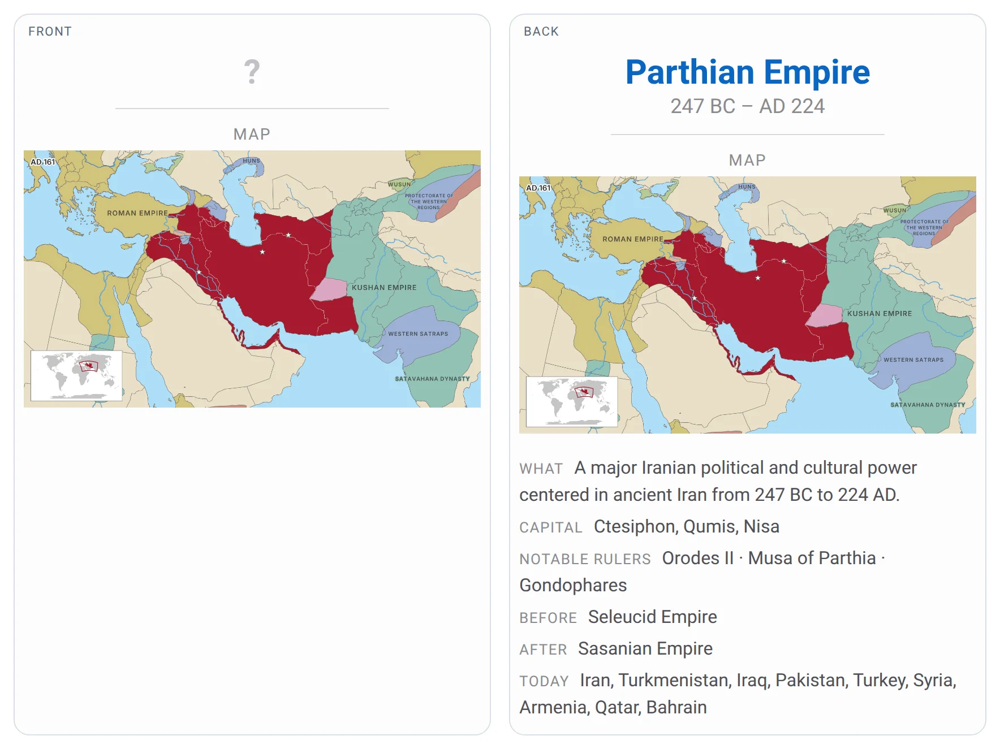
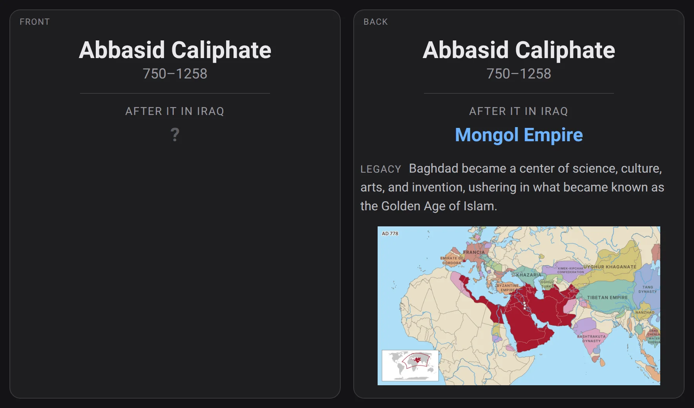
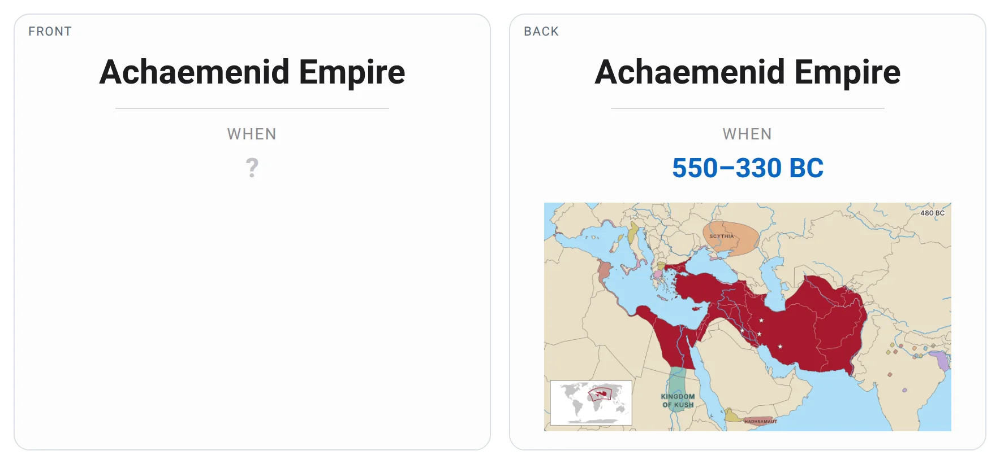
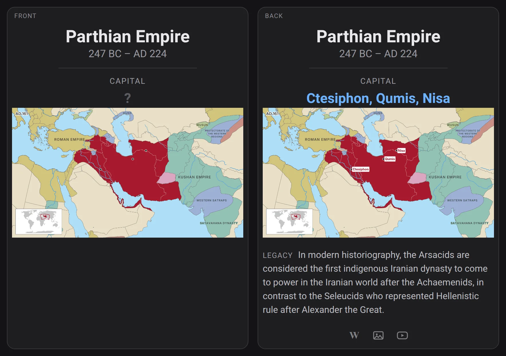
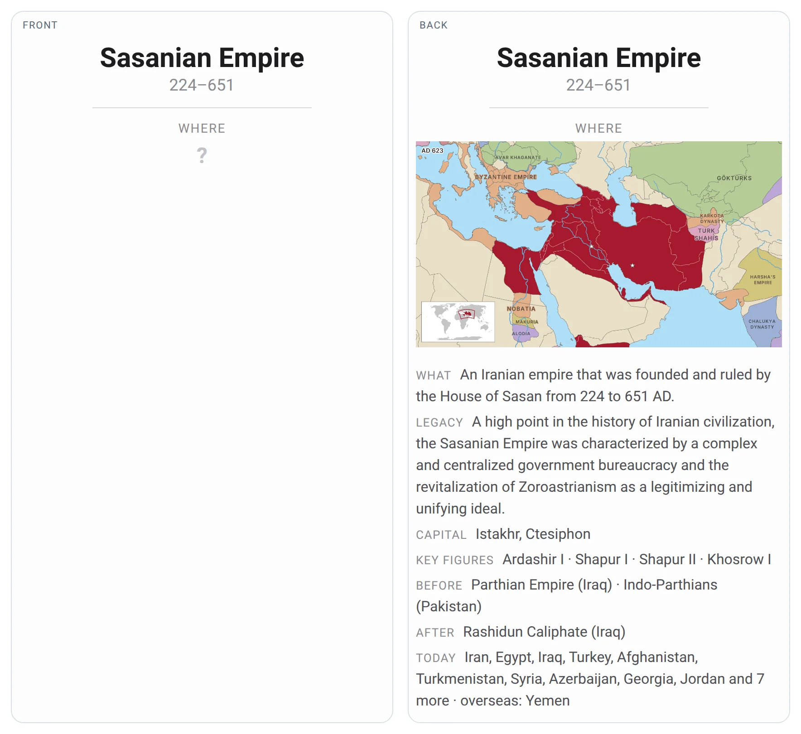
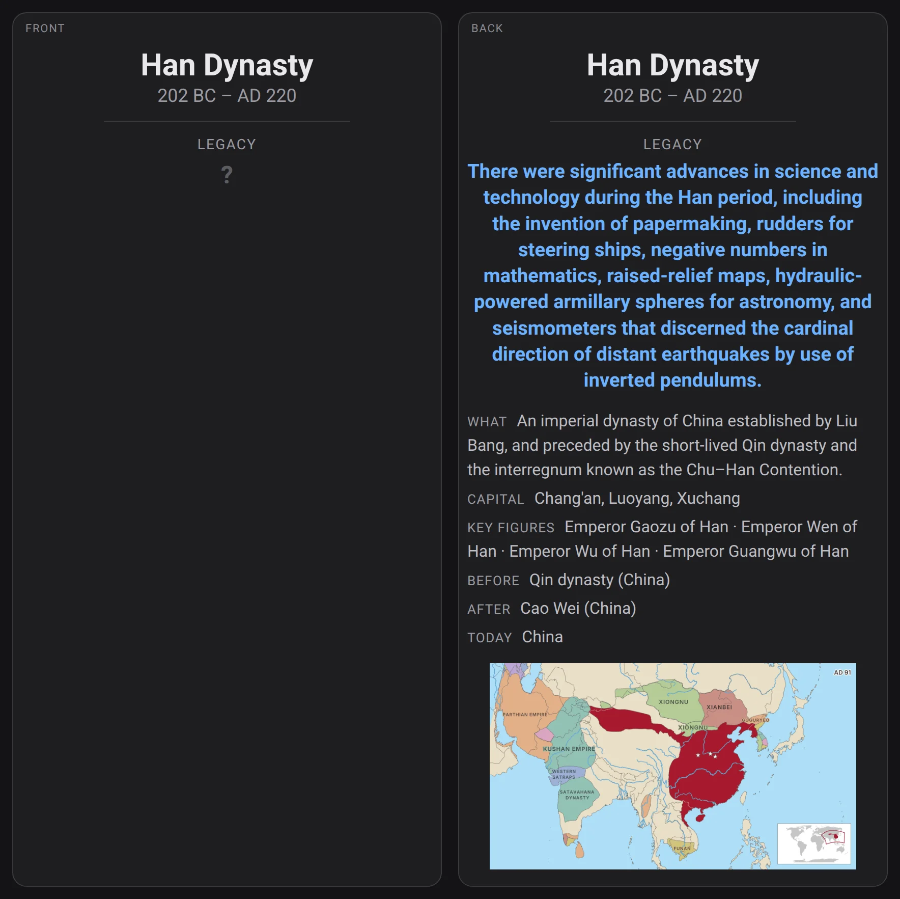
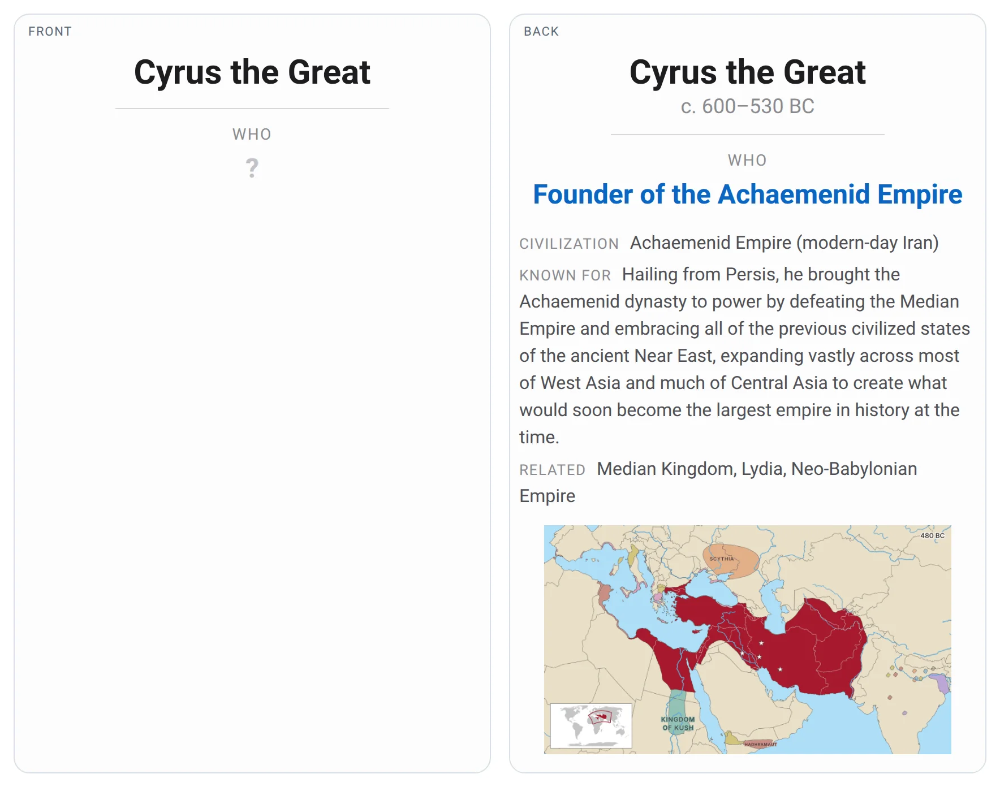
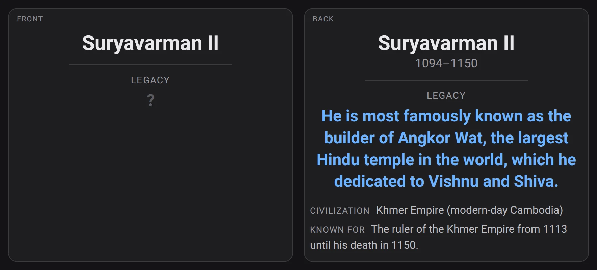

# Page in History

An Anki deck of civilizations and the people who shaped them, and the pipeline that builds it.

It covers the civilizations that Wikipedia's editors list as vital, that Wikipedia writes about in many languages,
that ruled a vast territory, or whose people are among the best known of their age, from Akkad and Old Kingdom Egypt
to the Samanids, the Ottoman and Qing empires and the United States, and the people who shaped them, chosen era by era
within each civilization. Most of today's countries are left to a geography deck. How everything is chosen is set out
step by step in [How the deck is chosen](#how-the-deck-is-chosen).

Every value comes from public sources through code: a field is filled only when independent sources agree, and is left
empty otherwise. A reviewed list of sourced overrides fills or corrects what the automated sources miss (see
[Building it yourself](#building-it-yourself)).

## The deck

One deck with two note types; each kind of question is its own card type. The civilization is the hub and every figure links to
one, so the cards build a web: Cyrus → Achaemenid Empire → its map, its neighbours, what came before and after.

### Civilization notes

| Card | Question | Answer | Made only when |
|---|---|---|---|
| Map | the map, with every neighbour labelled | the civilization and its period | Cliopatria draws its borders, unless it is a regime of 30 years or less drawn almost exactly like an adjacent one (France's Second Republic and Second Empire), which only the year would tell apart |
| After | Abbasid Caliphate, after it in Iraq: ? | Mongol Empire | the next ruler of its home region is confirmed (see below) |
| Before | Sasanian Empire, before it in Iran: ? | Parthian Empire | the previous ruler of its home region is confirmed |
| Before2, Before3, After2, After3 | Mongol Empire, before it in Kyrgyzstan: ? | Kara-Khitans | another region it took over or handed on (up to three a side) |
| Period | When: Achaemenid Empire | 550–330 BC | the period is confirmed, or Wikidata gives it as approximate (c. 57 BC – AD 892 for Silla), or the state still exists (since 1867 for Canada) |
| Capital | Parthian Empire, capital: ?, on its map with the capitals dotted | Ctesiphon, Qumis, Nisa, named on the map | it has a capital; the map only when a capital's place is known |
| Where | Where: Sasanian Empire | its map | it has a Map card |
| Legacy | Han Dynasty, legacy: ? | what it is remembered for: "There were significant advances in science and technology during the Han period, including the invention of papermaking…" | a sentence of its article says it well enough (see below) |

<p>
  
  
  
  
  
  
</p>

The backs of the Map, Period and Where cards also show what the civilization was (the opening sentence of its Wikipedia article without its
subject, cut at "was", "refers to", "comprised" and the like; or its short description when that sentence cannot be cut
or begins with a circumstance, "Under Islamic rule …"; when the article describes a place as it is today though the map
stops drawing it before 1900, only a short description that dates it, "Ancient Mesoamerican city" for Teotihuacan, and
nothing for medieval Norway), its legacy, the capital, key figures, the civilizations before and after, and the modern
countries on its territory. The backs of the other cards show its legacy too.

The legacy line is one sentence of the civilization's English Wikipedia article, chosen like a figure's (see below) but
scored for what the civilization is remembered for: inventions, law, institutions, religion, art and monuments, writing,
science, trade, its influence on later peoples, being the largest or first of its kind, rather than its dates, extent,
succession of rulers, a single event or one ruler's deeds. It needs a score of at least 7, and a sentence that mostly
repeats what the civilization was, that leans on the one before it ("However, …", "This …", "As a result", "the latter"),
that speaks of an unnamed ruler ("He consolidated …"), that gives a pronunciation or that Wikipedia tags as unsourced is
not used. Its name is not hidden, since the card names it. Every line was reviewed by hand; one that speaks of another
state or period, a single event, trivia or a sentence it leans on is listed in `data/errata.toml`, and the next best
sentence is used instead, or none. When neither the introduction nor a legacy section has a line, the cited sentences of
the whole article are scored as for a figure (see below).

When reputable sources disagree on a period's start or end, or on what came before or after in the home region, the card
shows every value with its source: "First Bulgarian Empire or Francia", or under a period "Sources differ on the end:
c. AD 550 (Wikipedia) · c. AD 600 (World History Encyclopedia) · c. AD 750 (Britannica)". The map and the year it is
drawn for follow the first of them. When what came before or after is the same state under another name, such as the
Portuguese Empire and the Portuguese Republic, the card says so.

Historians use "succession" in several ways: legal succession of modern states, claims of legitimate descent, and
the sequence of rulers of a region. The deck asks only the last, which is a matter of record: who ruled the
civilization's home region right before and right after it. The home is the capital it held longest (Baghdad for the
Abbasids), or, without a confirmed capital, the spot it held for the most years; the region named on the card is the
modern country around it. So a conquest counts (Babylon, then the Achaemenids, in Iraq), while losing a province does
not, and the answer may be a civilization that is not in the deck itself.

Each map shows the civilization in red at its largest extent within its confirmed period (and up to 1945, where it was
drawn by then), preferring years when it holds more of its capitals so that a year of foreign occupation is not shown,
nor one when its homeland is drawn as another state (Macedonia in 323 BC, not 318 BC, when Cliopatria draws Macedon
under the regent Polyperchon); a last step that begins when the period ends and is a fifth or more larger than the one before it is the successor's shape and is passed over (the German Confederation in 1815, not the Prussian annexations of 1866), with the year in a corner and a small world
map showing the whole civilization in red. States Cliopatria draws separately are painted with it when Wikidata lists
them as its parts (Spain within the Spanish Empire) or files them as part of it (French Indochina in the French
colonial empire), and, in the map's year, when Cliopatria itself groups them under the same item: all of them for a
state Wikidata classes as a colonial empire or colonial power (the British Raj, British Africa and Britain itself in
the British Empire, Portugal in the Portuguese Empire, the Cape and Ceylon in the Dutch Republic), otherwise only those
bordering its own territory, so the French republics do not repaint the French colonial empire. The main map is framed on its home region, the land
around its capital, so a few distant colonies do not shrink it to a speck; an empire Cliopatria draws without its
homeland (the French colonial empire without France) is framed on the region nearest its capital, widened to show the
starred capital; other regions holding at least a tenth of
its territory, such as Portugal's Angola and Mozambique, get up to three panels beside it, except that a state that is not
a colonial power gets none for a lone region under a quarter of its territory that holds none of its capitals, beside a home region that does (French
Guiana for the French regimes), which would suggest it was all they held overseas. A region spanning a third of
the globe is drawn on the Equal Earth projection, and a civilization too small to spot at its map's scale, such as a
city-state, is circled. Neighbouring civilizations of that year are coloured so that touching ones
never share a colour, and labelled when their name fits inside them. Today's borders are drawn in the same thin line
as the historical ones, light over the civilization and grey elsewhere, so you can see which modern countries it
covered. Capitals are marked with stars where the civilization holds them that year and they had been founded by then, and major rivers are drawn. Historical borders are smoothed by about a pixel
and cut to today's coastline.

### Figure notes

| Card | Question | Answer | Made only when |
|---|---|---|---|
| Who | Who: Cyrus the Great | Founder of the Achaemenid Empire, with what they are known for, their civilization and its map, and today's country at their birthplace (Moshe Dayan: Ottoman Empire, modern-day Israel) | always |
| Photo | a portrait | the person | a photograph of them alone is found (they died in 1860 or later; see below), or their Who card picture is a portrait made in their lifetime |
| Legacy | what they are remembered for, without their name: "He is most famously known as the builder of Angkor Wat…" | the person | a sentence of their article says it well enough (see below) |
| Legacy reverse | Suryavarman II, legacy: ? | what they are remembered for | as for Legacy |

<p>
  
  
  
  
</p>

Photographs and portraits made in the person's lifetime are asked about; the back of the card says which it is. The
back of the Who card shows the person's picture labelled by kind: a photograph,
a portrait from life (made in the person's lifetime, by its Commons date), a later depiction (dated long after their
death: an artist's idea of someone who could not be painted from life), or a depiction when Commons gives no date. Depictions are never asked about, and statues, busts, reliefs and coins are never used.

When a photograph is found it is also the Who card's picture. When someone's main Wikidata image is a painting,
as it is for many rulers, the person's other Wikidata images and the files in their own Commons category are tried:
first Wikidata's, then the files most used across Wikipedia's articles, up to ten. A file is accepted when an image
model ([CLIP ViT-L/14](https://github.com/openai/CLIP), run locally on the CPU) sees a portrait of one person rather than
a group, a building or a document, and judges it a photograph rather than a painting, drawing, print or a photograph of
a statue: on its own when it is sure, or when Commons agrees, by a photographic category, by classifying the file as a
photograph, or by a capture date during the person's lifetime. On 410 old portraits labelled by Commons categories
(daguerreotypes, cartes de visite, cabinet cards against paintings, engravings, lithographs and drawings) it found 181
of 200 photographs at the lower bar and wrongly accepted 2 of 210 pictures that were not, both of them mislabelled on
Commons. Without the model (`--photos metadata`), a file is accepted only when a photographic Commons category says so,
which finds fewer photographs.

### Tags

Notes are tagged so you can filter or suspend groups of them:

- category: `PIH::Category::Civilizations` or `PIH::Category::Figures`
- civilization: `PIH::Civilization::Sasanian_Empire`, on the civilization and on every figure linked to it
- century: `PIH::Century::BC::06th`, `PIH::Century::AD::03rd`, every century of a civilization's period or a figure's life
- country: `PIH::Country::Iran`, the main modern countries of a civilization and its home region, or today's country
  where a figure was born when the sources agree on the birthplace, as their card names it
- occupation: `PIH::Occupation::Philosopher`, for figures
- tier: `PIH::Tier::Essential` for the civilizations on Wikipedia's 1,000 vital articles (Vital Articles level 3), about
  20, which also carry `PIH::Tier::Core`; `PIH::Tier::Core` for those on its 10,000 (level 4), and for those on
  its 50,000 (level 5) that were vast and lasting, their drawn area summed over their years reaching 150 million
  km²·years, a million km² for 150 years, without being colonies (the Rashidun Caliphate, the Ilkhanate), and for any
  other state that took part in, or was the country of, at least 15 wars, battles, revolutions or treaties known in 30
  or more Wikipedia languages (the Dutch Republic, the First French Empire), about 240 with the Essential ones;
  `PIH::Tier::Extended` for the rest, which you may suspend. A state counts as listed when a listed dynasty is its own
  (the Safavid dynasty for Safavid Iran), when it bears the name of a listed people or order (the Aztecs for the Aztec
  Empire, the Teutonic Order for its state), when it holds the name of a listed dynasty of its time (the House of Habsburg for
  the Habsburg Monarchy), when it stands for a listed people the catalogue leaves out as its own
  (the Göktürks for the Göktürk Khaganate), or when it is part of a listed civilization the deck does not have itself
  (the Roman Republic and Empire of Ancient Rome) or of a listed era that names it among its parts (Shu Han of the
  Three Kingdoms). Peoples and mapless civilizations without a capital, key figures or a confirmed period (the Brythons), countries that still
  exist (the United States, Mexico), and eras without a capital or confirmed period, whatever figures they have (the
  Viking Age), are Extended. A state whose neighbouring phase of the same name is Core or Essential is Core too (the
  Caliphate of Córdoba beside the Emirate of Córdoba). Tiers judge the civilization as its cards show it, after the
  overrides, and an override can set a tier by hand with its reason (the Saxons, a people the sources give a duke and
  a period, stay Extended)

To study one kind of question, make a filtered deck from a search such as `card:Capital`,
`tag:PIH::Category::Figures` or `tag:PIH::Tier::Essential`. To skip a kind, find it in the browser and suspend the
cards rather than deleting them: deleted cards come back when you import an update.

## How the deck is chosen

### Sources

| Source | What it provides | Used for |
|---|---|---|
| [Cliopatria](https://github.com/Seshat-Global-History-Databank/cliopatria) (Seshat) | Borders of about 1,600 polities from 3400 BC to 2024 | Which civilizations exist and when, maps, neighbours, succession, where people lived and died |
| [Wikidata](https://www.wikidata.org/) | Structured facts about states and people | Identities, dates, capitals, offices, citizenship, places of death |
| [English Wikipedia](https://en.wikipedia.org/) | Infoboxes, opening paragraphs, categories, the [Vital Articles](https://en.wikipedia.org/wiki/Wikipedia:Vital_articles) lists, the number of language editions | Notability and periods of civilizations, capitals, what a figure is known for, placement votes |
| Other-language Wikipedias | The country infoboxes of a civilization's featured, good and recommended articles, as Wikidata marks them | The state before or after a civilization when nothing else names one |
| [Cross-verified database of notable people](https://doi.org/10.21410/7E4/RDAG3O) (Laouenan et al., *Scientific Data*, 2022) | 2.29 million people with their Wikidata id, region, period and a visibility score built from language editions, page length, page views, external links and biographical completeness | Who can be a figure, how figures rank against their contemporaries, and a check on birthplaces and birth years |
| [Meta-Wiki's list of articles every Wikipedia should have](https://meta.wikimedia.org/wiki/List_of_articles_every_Wikipedia_should_have) | 1,000 articles chosen by editors from many language communities | A safety net: the people on it are always considered |
| [Pantheon](https://pantheon.world/) 2025 | Occupation and birthplace of 88,000 well-known people | Leaving out occupations such as sport and entertainment, telling rulers from others, the birthplace vote and the birthplace a figure is filed under |
| [qwen3.5:4b](https://ollama.com/library/qwen3.5) through Ollama | A score from 0 to 10 for each sentence of a figure's or civilization's article introduction (and legacy sections) | Choosing the legacy line |
| [Natural Earth](https://www.naturalearthdata.com/) | Today's borders, coastline and rivers | Maps, modern countries, today's country at a figure's birthplace |
| [Wikimedia Commons](https://commons.wikimedia.org/) and [CLIP](https://github.com/openai/CLIP) | Images and an image model | Portraits and photographs |

### Procedure

1. **Catalogue.** Every polity Cliopatria draws, tied to the Wikidata item of its Wikipedia article, plus states on the
   Vital Articles lists that Cliopatria does not draw, such as Classical Athens and Sparta (see *Civilizations* below).
   A drawn shape whose article Wikidata files as a civilization, an archaeological culture, a historical period, a
   historical people or an archaeological site rather than a state counts too, when the article is in at least 40
   languages and the shape is drawn for 50 years or more before 1900: the Maya, the Indus Valley, the Minoans, Heian
   Japan, the Huns, Teotihuacan. A shape tied to an article on a civilization's history stands for the civilization
   when Wikidata links the two both ways (Cliopatria's Sumerian city-states, linked to History of Sumer, are Sumer).
   Shapes tied to a person, a city, a region, a dynasty, a modern people or movement, a
   war or a treaty do not. Names that share one item and are drawn within its dates are one civilization under the
   name of its article: Cliopatria's Northern and Southern Song are the Song dynasty, its two Maya shapes the Maya
   civilization, its Eastern Roman and Byzantine Empire the Byzantine Empire. A state on the Vital Articles lists
   (levels 1–4) that Cliopatria draws only through its dynasties takes their shapes when they held its capital, lie
   within its dates and cover at least half of its years: the Delhi Sultanate from its five dynasties, the Chola
   dynasty from its Early and medieval Cholas. A people or dynasty drawn beside its own state is left out, so one
   thing is not asked twice: the Vandals beside the Vandal Kingdom, the Seljuk dynasty beside the Great Seljuk Empire,
   the Göktürks beside the Göktürk Khaganate. It is the state's people when its article has no country infobox and
   the state's has one, and the state gives it as its people, or it gives the state as where it applies, or it has
   ended and the state is the only one named like it once the kind of state is set aside whose dates overlap its own
   by more than 25 years and whose land meets its own. Its shapes stay on the other maps under its own name. Phases
   and parts of one state are not peoples and stay: the Emirate and Caliphate of Córdoba, Silla and Unified Silla,
   Tenochtitlan and the Aztec Triple Alliance.
   Cliopatria sometimes keeps one name for a chain of states: its Kingdom of Great Britain runs to this day. Where a
   name runs more than 25 years past the dates Wikidata gives the state, the years beyond go to the successor (or
   predecessor) that both Wikidata and the Wikipedia infobox name and whose capital lies inside the borders it takes
   over, and so on down the chain: the Kingdom of Great Britain ends in 1801, the United Kingdom of Great Britain and
   Ireland follows until 1927, then the United Kingdom. The successor's own dates must meet the handover within 25
   years, or it must have begun while the state still stood and outlast the handover (the Almohads after the
   Almoravids). A successor that itself ended at the handover is passed through to its own successor (Florence's
   short-lived Duchy to the Grand Duchy of Tuscany), and one that is a period of a country rather than a state hands
   the years to that country, if it already stood then (Sweden after its Age of Liberty). Years without such a
   successor stay with the original name, unless there are more than 50 of them: then no state is drawn there
   (Cliopatria's Tibet before 1912, its Ngô dynasty after 965). A name whose years miss its Wikidata item's
   dates by more than five years points at the wrong state (the modern region for early-medieval Aquitaine): a Wikidata state named exactly
   like it with overlapping dates stands in, or it leaves the catalogue. A nearer miss is the same state (the Palmyrene
   Empire, drawn until 269 and dated from 270).
2. **Civilizations notable on their own.** Any one of: Vital Articles level 4 or above; a Wikipedia article in at least
   60 languages; Vital Articles level 5 with 45 languages or a peak of 1 million km²; a peak of 2 million km² without
   being a colony; or a large and lasting state: its drawn area summed over its years reaching 12.5 million km²·years
   (250,000 km² for 50 years), with a peak of at least 50,000 km² and an article in at least 30 languages (the Kamakura
   shogunate, Shu Han, Funan). Wikidata's colony class counts only from 1500, since it also marks the Teutonic Order.
   A state that still exists qualifies only if Cliopatria draws it before 1930 and it reached 2 million km² (the United
   States, Mexico, Brazil), or if Wikidata dates its founding before 1930, Cliopatria draws it by 1945, the land around
   its capital reached 2 million km² and it does not continue a state already chosen (Canada, Argentina). A civilization that began in 1945 or later is left out, as the
   deck's figures are.
3. **Candidate people.** The database of notable people is split into cells: one of its 20 world regions (such as
   Eastern Asia or West Africa) in one period of birth (before 500, 500–1500, 1500–1750, 1750–1900, after 1900). Within
   each cell people are ranked by the database's visibility score, and the first 60 of every cell are candidates, so
   every part of the world and of history brings the same number and the many recent figures do not crowd out the few
   ancient ones. Everyone on Meta-Wiki's list of 1,000 is a candidate too. Left out: people whose adult life began in 1945 or later (someone who died before 20, as Joan of Arc, is placed over their whole life), sport, business and entertainment,
   and figures Wikidata files as legendary rather than human (Moses; Jesus is filed as both).
4. **Placement.** Each candidate is tied to the civilizations they belonged to as an adult, from seven sources
   (offices, categories, citizenship, the Vital Articles section, place of death, birthplace and the links in their
   article's opening), against the whole catalogue, not only the civilizations chosen so far; then their birthplace
   decides where two sources agree on it (see *A figure's civilization* below).
5. **Civilizations their people make notable.** A civilization that step 2 passed over joins when two of the people
   placed there are among the first 10 of their cell, or one among the first 3, on Meta-Wiki's list or renowned (see
   step 9), as Confucius is for Lu, Laozi for Chu and Isabella I for the Crown of Castile. It must have begun before 1930 and reached 20,000 km², so Finland and the United Kingdom
   join through their people but later republics do not.
6. **Segments.** Each figure belongs to their first civilization in the deck, or else to their first state even when
   it has no civilization card: the card then names the state (Ibn Saud, Kingdom of Saudi Arabia). A state is split into eras of at
   most 150 years, so the Ottomans' six centuries are five segments and the United States' two and a half centuries
   two, and people compete only with their contemporaries.
7. **Figures.** Within each segment, people are ranked by the database's visibility score. Chosen are the candidates
   from step 3, the segment's best person even when they are not one, and anyone on Meta-Wiki's list, at most 25 a
   segment, and beyond that anyone important: on Meta-Wiki's list or Vital Articles level 3 or 4, or among the first 20
   of their region and period by both the database and Pantheon, two rankings that each compare people only with
   their contemporaries, so Lermontov counts for Russia as Kurmangazy does for Central Asia. A crowded segment grows
   for its important people and nobody is pushed out. Composers are capped at 20 across the deck, the important ones
   aside. Two kinds of fill are then left out, never anyone important, anyone on a Vital Articles list or a
   civilization's only figure: royal relatives with no rule of their own known in fewer than 15 languages (minor
   princesses and consorts), and beyond the best-known two, the unlisted holders of one office of one state (the
   fifth Liberian president). Someone whose Wikipedia article exists in fewer than 10
   languages is left out unless they are on Meta-Wiki's list: such people are known mostly to specialists.
8. **Civilizations still empty.** For each deck civilization with no figure after step 7, the database's 30
   highest-scored people from the regions under its largest extent (and those it files under no region), whose adult
   life overlaps the civilization's years, and in each of its eras of at most 150 years the 30 highest whose adult life
   lies mostly within that era (so Kush is not left to the best known of one age), are placed by the same rules.
   Those whose first deck civilization is that
   one are added, the best of each segment, with the same language floor (Charles the Bald for the West Franks, Tamar for
   Georgia).
9. **Meta-Wiki's list and renowned people.** Everyone on Meta-Wiki's list who passed step 3 is in the deck, and so is
   everyone renowned: a candidate whose Wikipedia article exists in at least 90 languages (Herodotus, Rumi, Sun Tzu),
   though renowned people count towards a segment's 25 and are not kept beyond it. Both are kept even when no state can
   be found for them, by their region and the century of their adult life, shown as their setting (Aristotle, Southern Europe, 4th century BC). The region is
   the database's, or that of their birth country by Pantheon when the database gives none (Jesus, Western Asia).
10. **The rest.** People placed in a deck civilization but not chosen are listed in `data/extended.json` and are not
   in the deck; those placed only in states without a card are not listed.

Both people sources lean towards Europe and, for the last two centuries, North America. Taking the same number of
candidates from every region and period, and comparing people only with their own contemporaries, offsets most of it.
The database's own region and birth year are used only to form the cells and as one of the three sources that must
confirm a birthplace; segments and the 1945 cut use Wikidata's dates, since the database gets a few wrong (it gives
Shaka a birth year of 1971).
The deck still reflects who held power and was written about: about 9% of the figures are women.

### Details per field

| Field | Sources | Rule |
|---|---|---|
| Civilizations, borders, neighbours | [Cliopatria](https://github.com/Seshat-Global-History-Databank/cliopatria), Wikipedia Vital Articles (history and geography, levels 3–5), Wikidata | Polities Cliopatria draws that meet any of: Vital Articles level 4 or above; a Wikipedia article in at least 60 languages; Vital Articles level 5 with 45 languages or a peak of 1 million km²; a peak of 2 million km² without being a colony; a peak of 250,000 km² held for 50 years with an article in 30 languages. Shapes whose article is a civilization, culture, period or historical people count (the Maya, Heian Japan), and famous states drawn only through their dynasties take their shapes (the Delhi Sultanate). A sovereign state that still exists qualifies only if Cliopatria draws it before 1930 and it reached 2 million km² (the United States, Mexico, Brazil), or Wikidata dates its founding before 1930, it is drawn by 1945, the land around its capital reached 2 million km² and it continues no chosen state (Canada, Argentina). Any other polity without an end date must be classed as historical in Wikidata, and today's provinces and towns never qualify. States on the Vital Articles lists that Cliopatria does not draw, such as Classical Athens and Sparta, join by the same signals when Wikidata or the Wikipedia infobox dates them; city-states count although Wikidata also files them as settlements. Left out are items Wikidata files as a civilization (Ancient Egypt), umbrellas over drawn states (Ancient Rome over the Roman Republic and Empire), and states whose capital or location lies inside drawn civilizations of the deck for most of their years (the city of Babylon inside Babylonia). They have no map, but figures can belong to them. Civilizations also join through their people (procedure step 5). With `--region`: polities with at least 5% of the region, or 25% of their own territory inside it, and a peak of 50,000 km² or more |
| Identity of a civilization | Cliopatria's Wikipedia link, Wikidata | The article's Wikidata item must be a state; Cliopatria's own Wikidata ids are often wrong and only count when they match. An article Wikidata files as a list never counts (the Median dynasty, a list of kings). When the link fails, Cliopatria's own id or a Wikidata state named exactly like the polity stands in, if its dates overlap and it is the only one. A polity named after one stretch of a state that has ended takes the name of the state's article, so the name fits the dates and rulers shown: when Wikidata lists a part of the state named like it, or another state carries its name, within the state's dates and spanning at most half the years Cliopatria draws (Cliopatria's Western Jin is the Jin dynasty, 266–420; its Macedonian Empire is Macedonia, the kingdom from the 7th century BC). A country that still exists keeps the name of its present form (the Republic of Austria) |
| Period | Wikipedia infobox (start and end years, or the life span; of the article a title redirects to), Wikidata (inception and dissolution, or start and end time, or those of the culture it names when it gives none: Teotihuacan), Cliopatria | Each end needs two sources to agree (when Wikidata gives several dates, the one the infobox agrees with counts, as the Akkadian Empire's fall in 2154 BC rather than 2083 BC): within a year for modern dates and about 1% of a date's age for older ones (47 years at 2700 BC), or at least 25 years against Cliopatria's time steps. Centuries count as their whole range, and the most precise of the agreeing dates is shown; an end too coarse to follow the start (the 1st millennium BC after the 8th century BC) is no end. An infobox decade counts as its ten years (the 370s). A state that Wikidata says became part of its successor, naming the same state as both, ends when it joined (by the part-of start, the succession's date, or the successor's inception), if Cliopatria stops drawing it then: the Kingdom of Castile in 1230, in the Crown of Castile. Likewise a state ends where a later phase under its own name begins, a drawn state whose name contains its own that either names as successor or predecessor and that began within its dates (by its single inception), so the two follow each other: Silla in 668, at Unified Silla; the Kingdom of Aragon in 1162, at the Crown of Aragon. When they disagree, Wikidata's dates (single-valued and known to the century or better), or the infobox's where Wikidata gives none or several (c. 968–1804 for Đại Việt), within the infobox's, rounded out only as far as Wikidata's own precision (to the decade or century when it knows no more), are asked as approximate (c. 508–322 BC for Classical Athens, c. 370–470 for the Hunnic Empire); Cliopatria's drawn years do not narrow them, since the map often stops drawing a state before it ended. Civilizations without a map get one the same way (Dahomey, Mutapa). A state that still exists (drawn to Cliopatria's last year, with no end date in Wikidata) is asked from its confirmed start, or Wikidata's single founding year: "since 1867" for Canada |
| Capital | Wikidata, Wikipedia infobox and lead | Capitals both list, as the same item or as two items within 25 km of each other (Wikidata's Shuntian Fu, the infobox's Beijing), shown once per place (capitals 5 km or more apart are separate places, so Venice is listed beside Malamocco) under the name of the settlement Wikidata lists (Bursa rather than the infobox's Prusa), or the infobox's name when Wikidata's item is wider than a settlement. An item that is not a settlement, such as a historical park or an archaeological site, is shown as the town it lies in when that town is within 25 km (Ayutthaya Historical Park as Phra Nakhon Si Ayutthaya), unless it is an archaeological site whose name is not the town's (Gordion, not the modern Polatlı). A state is never a capital, nor is a province or county an infobox lists beside its city (Phitsanulok and Lopburi provinces for Ayutthaya), but a city Wikidata files as an administrative unit or a state (Paris, Bucharest, Tenochtitlan, Kathmandu) is, and a state one source names stands for the settlement the other names, or that Wikidata files as the civilization's capital (capital of, P1376), within 25 km (the Free City of Frankfurt for Frankfurt, capital of the German Confederation). The infobox's capitals are its linked places and, line by line, unlinked names (the Kingdom of France's "Paris (987–1682)"). Once the two agree on one, the infobox's other capitals count too when it writes years beside them that fall within the civilization's confirmed period (any years when the period is not confirmed) and they lie in its territory on the map (Nimrud, Dur-Sharrukin, Nineveh and Harran beside Assur for the Neo-Assyrian Empire). When the two share none, a capital either names counts if it lies in the civilization's own territory on the map (Hattusa, Susa, Gordion), or, for a civilization without a map, within 25 km of where Wikidata places it (Sparta); failing both, a settlement or site linked in the first sentence of the article's lead that speaks of a capital counts by the same test (Heian-kyō for Heian Japan, whose article has an era infobox without a capital). Wikidata's capitals of every rank count, but one it dates only outside the civilization's confirmed period (Cairo, seat of the Abbasid caliphs after the fall of Baghdad) or only from 1945 on (Brasília) is left out. A capital is starred on the map only if it was founded by the map's year |
| Before and after, by region | Cliopatria shapes, Wikidata, Wikipedia infoboxes of states and rulers, quality-badged Wikipedia articles in any language | The nearest holder of the home on Cliopatria's maps within 30 years (of the end the maps draw, or of the end of its period) that Wikidata or either civilization's infobox also names as predecessor or successor; failing that, the nearest whose succession they imply through a part of it, by Wikidata's part of or country (the Aztecs were followed by New Spain, part of the Spanish Empire), or through a part whose country lists the holder among its phases when the part began within 30 years of the change (Carthage was followed in 146 BC by the province of Africa, whose country Ancient Rome lists the Roman Republic; a part of a group of states such as the Five Dynasties does not count), though never a part of the civilization itself (the French Consulate in the First Republic). It must be in the deck or well known (an article in at least 40 languages), so no answer is obscure; failing one, a holder known in at least 20 languages stands in when the sources name it and it also took the largest share of the civilization's last (first) land the year after (before) (Northern Zhou before the Sui; not Former Shu after the Tang, drawn at Chang'an but not the main heir of its land). The region named is the home's modern country. An empire Cliopatria draws far from its capital (the British and Spanish Empires without Britain and Spain) has no before or after, since its home would be a colony. When Wikidata or the infobox dates the capitals within the civilization's period, a side is judged at the first or last capital if it lies in the home country, counting land the maps draw within reach of a coastal capital (Ming's successor at Beijing is the Qing; the Tang's, at Luoyang, Later Liang); one in another country gives an answer for that country beside the main one, so the main card is always asked in the home country. A neighbour named like the civilization itself, once "dynasty", a monarch's rank (kingdom, crown, electorate, emirate…) and brackets are set aside (Qin and the Qin dynasty), leaves that side unasked rather than giving way to a less fitting answer, unless the two are consecutive states: the later began within 5 years of the earlier's end, and both began and ended more than 5 years apart (the Kingdom of Castile before the Crown of Castile, the Emirate before the Caliphate of Córdoba). Failing a holder in the window, a deck state that both civilizations name as each other's neighbour, within 30 years and drawn within 2 degrees of the home at the change, that held the home on the maps or has its own home in the same country (not Sweden-Norway after Denmark-Norway, drawn across the strait from Copenhagen); then a deck state the sources name that held the home up to a century away, with no other deck state holding it in between (Babylonia → Achaemenid Empire, Ghana → Mali). More come from the rulers: the successor (predecessor) the last (first) leader in a civilization's infobox has in their own infobox, when that person led exactly one other deck civilization, which began within 30 years and held the civilization's home on the map (Kingdom of Scotland → Kingdom of Great Britain; not Great Britain before Hanover, a shared crown). Each link also counts from the other side, in the region it names (Achaemenid Empire before Macedonia in Iran; Ghana Empire before the Mali Empire in Mauritania). The later of two must begin after the earlier begins, within a century of its end, and end after it ends, by their periods or, for one not confirmed, the core years its sources agree on (Four Oirats before the Dzungar Khanate); a last check holds every answer, however it was found, to the same years (the confirmed period, else the core its sources agree on, else the years since it began or the years the maps draw it): a predecessor must have begun before the civilization, a successor must end after it, and the later must begin within a century of the earlier's end (not the Four Oirats after Northern Yuan, which outlasted them, nor Majapahit after Srivijaya, 268 years before); every answer must be able to have followed: a predecessor began before the civilization, a successor ended after it (Assyria is not followed by the Neo-Assyrian Empire, which ended first), neither is a part the other absorbed (unless the part ended within 5 years of the whole's start, as the Kingdom of Castile did when the Crown of Castile began), the answer is not a part of the civilization, by Wikidata's country or part of, that ended with it (not the Antigonid dynasty after Macedonia), and they are not phases of one state under a shared name with one period inside the other (Qi before Qin). A home still empty takes a state outside the deck that Wikidata, the civilization's infobox or the state's own Wikidata item names before (after) it, known in at least 20 languages, that ended (began) within 30 years of its start (end), and that is not a city, a subdivision, an event or a mere occupation zone (not Mexico City after Tenochtitlan, nor a zone of Allied-occupied Germany): one drawn on the maps must have held land within 2 degrees of the home at that change (Singhasari before Majapahit, the Zagwe dynasty before the Ethiopian Empire) or, when two sources name it, held the home at some time; one not drawn needs two sources naming it, and among such the one whose place lies in the home country comes first (the First Intermediate Period after the Old Kingdom of Egypt, the July Monarchy after the Bourbon Kingdom of France, the Seventeen Provinces before the Dutch Republic, the Kingdom of Cusco before the Inca Empire). A home still empty after that takes the state that the civilization's quality-badged Wikipedia articles list first as predecessor (successor) in their country infoboxes: the articles Wikidata marks as featured, good or recommended (or as a featured or good list) in any language, one vote per language for the first entry of the predecessor (successor) field, whatever the language calls it (p1, Voor1, előd 1, edeltäjät, 先代1, VORGÄNGER…), a redirect followed to its Wikidata item. At least two languages must agree on it, with no other state named as often; it must be in the deck or known in at least 20 languages, a state by Wikidata's kinds (not a city, subdivision, event, period, culture or people), not named like the civilization, able to have followed it as above, and, if drawn on the maps, have its own home in the region or have held the civilization's home (Khamag Mongol before the Mongol Empire, Buyeo before Goguryeo). A home still empty after that takes the state the sources agree on. The candidates are those the civilization's Wikidata names on that side, Wikidata items that name the civilization, and its infobox, when in the deck or known in at least 20 languages, a state by Wikidata's kinds as above, able to have followed it as above, not yet an answer, and, if outside the deck and drawn on the maps, having held the home or land within 2 degrees of it within 30 years of the change (not the Taifa of Granada before the Almoravids in Morocco); items of one state, named alike or said to be the same, count once. Each of up to six voters puts forward its first candidate, tied candidates sharing the vote and a voter whose best has less than 0.3 of support backing none: the civilization's own Wikidata statements, the Wikidata items that name it, the order of its infobox, the date the state ended (began) against the civilization's start (end) (full support from 40 years before to 30 after the start, or from 30 before to 40 after the end, falling off over 40 years beyond), the maps' holding of the home (the share of the civilization's first or last shape it held within 30 years, plus one if it held the home point within 30 years of the change or half of one if it held land within 2 degrees of it, plus a quarter if it was ever drawn that close), and, among several candidates, a language-inference model (DeBERTa v3 base trained on natural-language inference, pinned to one revision and run on the CPU; its readings are kept with the data) that reads the passages of the civilization's article naming each candidate and weighs whether the candidate followed (preceded) the civilization. A candidate is filled when three voters put it first, one of them with half of its support or more (not the Republic of Genoa before the Kingdom of Sardinia, which three weak signals favoured) and one of them past the first three, which restate one Wikidata or infobox link (not the Zaporozhian Sich after the Cossack Hetmanate), and, among several candidates, it leads the runner-up by two votes (the Western Chalukya Empire before the Hoysala Kingdom, the Hausa Kingdoms before the Sokoto Caliphate). An answer from the other side or a leader stands in the home region only when the two overlap by 5 years at most, or by 30 when it held land within 2 degrees of the home at the change, and, when both are on the maps, only if it held the home at some time (not Srivijaya before Majapahit). One civilization per region, the closest in time, at most three a side, each its own card. The first card is the civilization's home region: today's country at the capital it held longest within its years, a capital Wikidata or the infobox dates counting the years of its terms (Székesfehérvár for Hungary, not Timișoara, capital for eight years; Bianjing for the Song, not Yangzhou, capital for a year) and one it does not the years the maps show it held, but no more than the years the dated ones leave (Vienna for Austria-Hungary); without a capital in hand, the place Wikidata gives as its capital or location (Frankfurt for the German Confederation); when no capital is dated and the infobox names first one that no source places, the capital held is a later seat, so if it lies in another country than the spot the maps show held longest and more than 10 degrees from it, the home is that spot (the Göktürk Khaganate in Mongolia, not at Suyab, seat of its western half); the others are other regions. Holders that stayed 5 years or less, such as wartime occupations, are passed over, unless Wikidata and the infobox both name one that lasted longer and no longer-held holder answers (Cao Wei after Shu Han); Cliopatria names that share a Wikidata item count as one civilization; and an empire whose last territory went in large parts (15% or more each) to three or more states has no single successor, unless the civilization outlasted its last map by over a century (the Zhou, drawn until 751 BC, lasted to 256 BC) |
| Key figures | Wikidata, the deck's figures, Wikipedia infoboxes of the civilization and of each person, a language-inference model | Up to four people central to the civilization, in order of when their rule began (the years Wikidata, the infobox or the figure's role give; else when they first took a head-of-state office; else a ruler from the age of thirty-five and anyone else from fifty; two beginning in one year go by which term ended first). The candidates: those Wikidata records as its head of state within its period, holders of its own head-of-state office (not a generic office such as "king", which would take every king), members of the dynasty it is who took an office before 1945, figures whose role says they ruled it, the people its infobox lists as leaders, deputies or representatives, the deck's figures filed first under it, and those filed first under its predecessor or successor whose role names a ruler, statesman or general (Zhuge Liang for Shu Han). The office its Wikidata head of state names counts as its head office (the Doge of Venice), a sovereign state with none and one country today takes that country's heads of state (the presidents of France for the Third Republic), and a state left with hardly any candidates takes its citizens who held a head office (Pharnavaz I for Caucasian Iberia). A state with no head of state or head office of its own takes those of its parts named for it (the Kingdom of Prussia for Prussia) and, for a colony or colonial empire, of the state it belongs to or replaced (Castile and Spain for the Spanish Empire). Its years are its confirmed period, else the core its sources agree on. Infobox rows titled for another state are passed over (a Seljuk sultan for the Zengids), as are the other rows when one row's title is the state's own office (shoguns, not emperors, for a shogunate), and people born after a row's years (Mahmud II for Karaman). A model reads each person's own Wikidata description and infobox titles and weighs ruler of it against consort, servant, ruler of another state and private person (BART large trained on MultiNLI, pinned to one revision and run on the CPU; its readings are kept with the data so every build gives the same answer). Rulers come first: those tied to its head office, head of state or infobox leaders, and those the model reads as its ruler; its own rulers before those who ruled it in union from a larger realm (James I before Charles V for Aragon), told apart by their title, their role and the years of their head offices; a title naming another deck state of their time that is neither its predecessor nor its successor means another realm (Christian I of Denmark for Sweden). Someone listed only by its infobox is left out when the model reads them as another state's ruler and their titles say they ruled another deck state but not this one (Casimir III, King of Poland, for Galicia–Volhynia), or reads them as a private person and nothing said of them names the civilization or the row's office (a theologian linked among the Avar khagans, but not the Mahdi); so is the spouse of one of its rulers who is not tied to it (Teresa Cristina), and a deck figure whose role says they ruled another deck state (Alauddin Khalji for Karaman) or carries no ruling title. Then up to two others: deputies, and its own figures the model reads as rulers or servants (Pericles, Hannibal), not private people. Within each group by fame (Wikipedia languages), lowered for a union ruler by the share of their rule spent elsewhere and for a reign under three years by its length; anyone known in under a third as many languages as its best-known ruler is left out, and the rulers are spread over its history when the best known cluster in one part of it |
| Modern countries | Cliopatria, Natural Earth | Countries with an ISO 3166 code (so not the Siachen Glacier or Northern Cyprus) covering at least 5% of the civilization's territory or with half their own territory inside it, under the shorter of Natural Earth's two names (Serbia, not Republic of Serbia); a dependency counts as its sovereign country (Hong Kong as China). Countries only in territory far from the capital (more than 800 km of sea or land away, as the map groups it; from the civilization's Wikidata location when it has no capital, as for Phoenicia) are listed after the others as overseas, a dependency there under its own name (Greenland, Macao, New Caledonia): the United Kingdom of 1956 is the United Kingdom, with Oman, Yemen, the UAE, Kuwait, Qatar, Cyprus, Bahrain and Malta overseas, since Cliopatria draws colonies and protectorates alike as the ruling state. The territory is the one the map paints; a civilization without a map has the country where Wikidata places it (Greece for Sparta and Classical Athens). An empire drawn without its homeland (the French colonial empire, its capital outside the territory) has no home to split off |
| Map: borders, coastline, rivers | Natural Earth | Rivers of scale rank 4 and above everywhere, rank 5 where they cross the civilization |
| Map: capitals | Wikidata coordinates of the confirmed capitals | |
| Figures | Cross-verified database of notable people, Meta-Wiki's list of 1,000 articles, Pantheon | See procedure steps 3, 6, 7 and 8 |
| A figure's civilization | Wikidata offices held and the leaders named in each state's Wikipedia infobox, Wikipedia "people of" categories, place of death (Wikidata) and birthplace (Pantheon) on the Cliopatria map, links in the article's opening paragraph, Wikidata citizenship, the Vital Articles section the person is filed under | At least two of the seven, counting only civilizations that existed during the person's adult life (from age 20): on the Cliopatria map, or after the map stops drawing a state until its Wikidata end date (the Holy Roman Empire, drawn only until 1621, counts until 1806), but never before the map begins. A civilization backed only by places and opening links, with no office, category, citizenship or Vital section for it, counts only when none of the person's other civilizations has more votes, so a death under a foreign occupation does not place someone there. Citizenship given as today's country counts for the Cliopatria state that held its capital during most of the person's adult life, when Wikidata ties that state to the country as an earlier form of it or by naming it as its country, so an occupier (Japan in Seoul) does not count; and as an umbrella civilization (Ancient Rome) for its parts that existed then, while they were part of it (Algeria of France only until 1962) and, when it has a capital, only those that held the capital at some time, so Cisleithania does not count for each of its crown lands. People on Meta-Wiki's list or renowned (procedure step 9) with no civilization confirmed can be placed by a single office, category, Vital section, citizenship or birthplace (Bach, Cervantes), but not by a place of death or an opening link alone. An office counts for the state it governs, or the state it heads, during the term: one naming it as its head-of-state or head-of-government office, unless it is a generic title Wikidata classes as a profession, rank, honorific or type of position (the Beylik of Karaman names "sultan", which would make every Sultan of Delhi its ruler), or, for an office Wikidata classes as a head of state or government, monarch, emperor, king or president, a state it names as its jurisdiction or country (Emperor of the French for the First and Second Empires); heading a state confirms it on its own. Being named among a state's leaders in its Wikipedia infobox counts as an office there (Askia Muhammad I for Songhai, whose Wikidata offices name no state). An office held by virtue of another, which Wikidata gives as a facet of that office (the French head of state as co-prince of Andorra), does not count. A category counts when Wikidata describes it as holding citizens, subjects or office holders of the state, so "collaborators with" and similar categories do not. States the person headed come first, so rulers are filed under the state they ruled (Napoleon under the First French Empire, Jefferson Davis under the Confederacy), the one headed longest leading when it was headed more than 1.5 times as long as each other; then civilizations whose own Wikidata dates meet the person's adult life (Tang before Sui for Xuanzang), then by support, a place of death counting half since exiles die abroad, then by adult years spent in each, then citizenship, then office, and cards show only those in the deck. Then the birthplace decides: the states the Cliopatria map draws at it in the birth year, smallest first, come first (Tesla under the Austrian Empire, Gödel under Austria-Hungary, and someone placed nowhere else gets a state), except for a ruler (by their offices, or by a description naming one of the states already found, as Vlad the Impaler's "Voivode of Wallachia"), someone holding an office of the state already found, or when that state held the birthplace at some time from a century before the birth to the end of the person's life, a later regime on the same land (Pasteur under the Third Republic, Bismarck under the German Empire). A birthplace counts only when every one of Pantheon, Wikidata and the database of notable people that gives it agrees, at least two of them, within 100 km and on the birth year within two years: the sources often copy each other, so one dissenting source is enough to leave it out (Mir Taqi Mir, whom two of them place in England rather than Agra). When the other sources' placement stands, the birthplace adds nothing, so a ruled state without a card keeps its ruler (Ibn Saud, Kingdom of Saudi Arabia). A state that held the birthplace for five years or less, an occupation, counts neither as the birth state nor as the same land (the American zone of Germany for Einstein, the American occupation of Cuba). Someone whose first state is one they ruled or held office in keeps it even without a card when no office, citizenship, category or Vital Articles section ties them to any of their deck civilizations, which then become related (Marcos under the Republic of the Philippines, not the United States, where he died) |
| Today's country at a figure's birthplace | The agreed birthplace above, on Natural Earth's borders | Only when the figure's state held the birthplace at their birth or later on the same land, so a ruler born abroad gets none; a dependency is named as its sovereign country |
| Name | Wikipedia | The article's title without its disambiguator (Fuzuli, not Fuzuli (poet)), kept when two figures would share a name (Francis Bacon, Francis Bacon (artist)) |
| Life | Wikidata | Birth and death years, as a range or centuries; "died …" when the birth is unknown or would make a life longer than 120 years, "born …" when the death is unknown |
| Role | Wikipedia short description, or Wikidata's description when there is none | Dates and centuries are removed, since the life years are shown separately |
| Contribution | Wikipedia opening paragraph, Wikidata | The opening sentence as written, without its subject (a sentence can end after a regnal number, an era or a quotation: "…grandmother of Mehmed IV. She…", "…224 AD. Its…", "…"the father of modern drama". He…", but not after "Dr.", "St." or "c."; a hatnote is skipped and a paragraph broken inside its parentheses is joined); when it adds fewer than two words to the role ("The tenth Mughal emperor from 1713 to 1719"), glosses the name ("Also known as …", "His form of address was …") or is left hanging once its dates are cut ("…who ruled from"), the next sentence that does; else Wikidata's description if it does; else nothing |
| Portraits | Wikidata, Wikimedia Commons, CLIP ViT-L/14 | The person's main Wikidata image, kept when the image model sees one person in it, compared with statues, busts, reliefs, coins, medals, groups, court and battle scenes, riders, signatures, seals, book covers, buildings, maps and text, and when Commons does not file it as an object (coins, stamps, plates, statues, busts, reliefs, effigies, burial suits, tombs, calligraphy; crowns or flags unless also filed as a portrait or as art). A later depiction gives way to a portrait from the person's lifetime the model sees clearly. Otherwise up to ten files from their own Commons category, but only those Commons files as a portrait, painting, drawing, engraving or photograph of the person, or photographs named after them in full, since the category also holds their works, relatives and scenes; tried best first by what Commons says before downloading (likely photographs, then made in their lifetime, then within 50 years of their death, then the rest; the most used first) and stopping once nothing later could do better. When nothing will do, the lead image of the person's English Wikipedia article, which the model must see clearly as one person. The picture is labelled a photograph, a portrait from life, a later depiction or, without a date, a depiction; for someone who died before 1900 a Commons date from 1950 on is when the artwork was photographed, so it counts as undated. Without the model (`--photos metadata`), the main image or a portrait category named after the person |
| Photographs | Wikidata, Wikimedia Commons, CLIP ViT-L/14 | See the Photos card above: a portrait of one person that the model is sure is a photograph (0.9), or fairly sure (0.7) with Commons agreeing; with `--photos metadata`, a photographic Commons category |

Cliopatria occasionally labels a single time step with the wrong shape (Alexander's empire appears as the Ptolemaic
Kingdom for 326–324 BC). A step more than 2.5 times larger than both its neighbours is ignored and reported by
`check`.

## Building it yourself

Requires Python 3.13 and [uv](https://docs.astral.sh/uv/).

```sh
uv sync --extra ml   # or plain `uv sync` and collect with --photos metadata
ollama pull qwen3.5:4b   # scores legacy lines; needed only for sentences not yet in data/legacy_scores.json
                         # (OLLAMA_HOST=http://other-machine:11434 uses another machine's Ollama)
```

```sh
uv run page-in-history collect   # select civilizations and figures, render maps into data/
uv run page-in-history check     # what was confirmed, what was left out and why
uv run page-in-history deck      # build build/page_in_history.apkg
uv run page-in-history samples   # render the sample cards shown above into docs/samples/, in night mode
uv run pytest                    # check the data against its invariants and the cases outside reviews raised
uv run page-in-history review    # review what a collect changed in the fact files and approve it
```

Every collect rewrites the fact files, `data/civilizations/` and `data/figures/`. It writes into `data.partial/` and
replaces the data's output only once the whole run has finished, so a collect that fails leaves `data/` as it was.
`review` compares them with the last
commit field by field, shows each change as old → new with the sources of any override behind it, and asks per
civilization to accept, reject, accept all the rest or skip. Only a review that accepts every change approves the data,
for exactly its current contents. The pre-commit hook in `hooks/` refuses a commit of fact files nobody approved; enable it
once with `git config core.hooksPath hooks`, and turn it off with `review = false` under `[tool.page-in-history]` in
`pyproject.toml`. `review --approve` approves without asking.

The tests cover three things:

- **Rules:** the pure rules that read source text, such as infobox years, names and roles, lifetimes and century tags.
- **Invariants:** properties every civilization in `data/` must have. Softer rules, such as a successor ending after the
  civilization it follows, keep their accepted exceptions in `tests/accepted.toml`. A new exception fails the run, and so
  does a listed one that has gone, so every change to the answers is either clean or accepted on purpose.
- **Review cases:** facts outside reviews checked, kept in `tests/review_cases.toml`, with people matched by their
  Wikidata id. Cases still open run as expected failures, so fixing one fails the run until its `open` mark is removed.

`collect` builds the whole world by default. `--region` (a modern country as named by Natural Earth), `--start` and
`--end` (negative years are BC) limit it to one slice, such as `--region Iran --start -1000 --end 1000`. Downloads
and API responses are cached in `cache/`, so later runs work offline. Maps are cached there too, under a fingerprint of
everything drawn on them (the year's shapes, capitals, parts, base map, font and drawing code), so a later collect
redraws only the maps that changed.

Photographs are recognised with an image model by default. It needs the optional `ml` extra (`onnxruntime` and
`tokenizers`) and downloads about 800 MB of model files into `cache/` on first use. `--photos metadata` skips the model
and relies on Commons categories alone.

`data/errata.toml` lists answers the sources give correctly but the rules pick wrongly, as found by outside reviews: a
civilization's successor, predecessor, key figure, capital or modern country to drop, a state a figure was wrongly filed
under, a figure's Known for line or life dates to leave empty (dates Wikidata gives where no source does), or a civilization's or figure's legacy line to pass over for the next
best sentence, each with the review's reason. It only removes; nothing is ever added or changed by hand. `collect` applies it last, records what it dropped in `data/report.json`, and a
test fails on an entry that no longer matches anything.

`data/overrides.toml` is the reverse: a reviewed, sourced list of facts the automated sources miss or get wrong. An
entry names a civilization, one field (`before`, `after`, `period`, `capital`, `key_figures`, `map_year`,
`modern_countries`, `summary`, `legacy` or `tier`) and an action: `add` appends to a list, `set` replaces the field (the whole list for
capitals, key figures and modern countries; `{ start, end, circa }` or `{ since }` for a period, each a year or, when the source gives only that, a century such as
`"6th century"`) and `none` records that
the field does not apply, with the reason, in the civilization's `checks.not_applicable`, so a deliberate gap can be told
from a missing one; `dispute` records another value a different source gives for a period's start or end, or for the
home `before` or `after`, which the card shows beside the deck's own; `same_state = true` on an added `before` or `after` marks it as the same state
under another name. Setting `tier` is an editorial choice rather than a fact, so it gives its reason in `note` instead of a source.
A `period` set by an override that leaves the map year outside it has the largest extent found again within it.
Setting `map_year` redraws the map at that year, and the parts and modern countries follow it unless
an override sets them as well. Each entry cites its source, a web page or a book with the page number, quotes the passage and gives the date it was read. A
fact no single page states is built from smaller ones: the entry lists `sources`, each the fact it supports, its page
and the quote, and names in `derivation` the rule that combines them (every listed person's own biography names them a
ruler of the state; the conquest that ended it falls within 30 years of its end). An entry flagged `needs_verification` is applied too but may leave the source empty, and is listed under
`needs_verification` in `data/report.json` for a manual check. `collect` applies the list after the errata, records it in
`data/report.json`, and fails if an override contradicts an erratum or a test finds one missing from the data. Errata
entries carry the same source, quote and flag. A test lists every civilization with a field neither filled nor marked not
applicable.

`data/figure_overrides.toml` does the same for figures. An entry names the figure and its Wikidata id and sets one
field: `civilization`, the state the person belongs to, with its Wikidata id, for someone the rules file under a
birthplace they have no tie to (Tolkien, born in Bloemfontein); `contribution`, the "Known for" line; `role`, for
when the Wikipedia text the deck reads has gone wrong; `life`, the life years the card shows, when Wikidata's are
wrong (Ibn Yunus died in 1009, not 958); `legacy`, the legacy line, with the person's name hidden as on the card; or `exclude`, which leaves out a figure of legend that Wikidata files as a
real person (Longinus), an editorial choice that gives its reason in `note` instead of a source. Each cites a web page or a book with the page, quotes the
passage and gives the date it was read; further `sources` (each with the fact it supports and its quote) and a
`derivation` saying how they bear on the value may follow.

A legacy line set by hand, for a civilization or a figure, is a sentence quoted as it stands (the name hidden for a
figure), never a paraphrase, from an openly licensed source: the English Wikipedia article, or for a few the public-domain
1911 Encyclopaedia Britannica article Wikidata links to. It is either a
sentence a footnote covers, or one of the article's unfootnoted introduction that Britannica confirms, quoted in
`sources`; Britannica is never card text. These were chosen for the Core civilizations and for figures with articles in
40 or more Wikipedia languages that the rules left without a line. The state comes first among the person's civilizations, so their segment,
card and today's country at the birthplace follow it, but it does not bring a civilization into the deck. An entry for
someone the deck does not hold this time is listed under `figure_overrides_unused` in `data/report.json` instead of
failing the collect.

The legacy line is one sentence of the person's English Wikipedia article: the sentence of its introduction, failing that of
a section headed Legacy, Assessment, Reputation, Historiography or the like, and failing that of any sentence of the article
a footnote covers (back to the previous footnote in its paragraph, none in a paragraph with a "citation needed" or under a
citation warning), that a language model scores highest, from 0 to
10, for saying what the person is remembered for (works, discoveries, foundings, conquests, reforms, firsts) rather than who
they were, their offices, family or trivia; it needs a score of at least 8, so people known only for holding an office
have none. Like a civilization's, the line must stand on its own: one that leans on the sentence before it ("However,
…", "Three months later …", "In this position …", "The event …") is not used. The person's name is replaced by "this
person": each whole form of it (the article's own, the name it opens with, what its first sentence also calls them,
"Joan of Arc", "Lakshmibai, Rani of Jhansi"), and a run of their own name's words, with middle names, regnal number and
epithet inside it ("Alan Mathison Turing", "Tamar the Great"). A word of their longer or other names standing alone
may be someone else, so the sentence is not used: Augustus for Tiberius, his father Ali for Hasan ibn Ali, Edward II
beside Edward III. Nor is a sentence used where any part of the name would remain, where the name is part of something
else's name (Rákóczi's War of Independence, the Tokugawa shogunate, the Fibonacci numbers, Sun Liang beside Sun Quan),
where a word is made from the name (Zoroastrian), where a title that ends the name stands on its own ("Khan overthrew
the monarchy"), that gives a nickname, pen name, courtesy name or other name ("nicknamed Scarface", "This person,
Rajasa, was"), that lists the person's names or gives a pronunciation, or that Wikipedia tags as unsourced; a title
right before or after the name goes with it ("King Olav's leadership" becomes "This person's leadership").
The model is qwen3.5:4b, run through a local [Ollama](https://ollama.com) at temperature 0 and pinned to one digest; its
scores are kept in `data/legacy_scores.json`, so a collect on the committed data needs Ollama only for sentences it has
not scored before.

Two language-inference models read texts for the successions and the key figures (DeBERTa, about 740 MB, and BART,
about 1.6 GB). They come with the same extra, are downloaded into `cache/` the first time a text is new to them, and their
readings are kept in `data/succession_scores.json` and `data/ruler_scores.json`, so a collect on the committed data
reads nothing again.

## Licence

The code is released under the [MIT licence](LICENSE). The data keeps the licences of its sources:

- Cliopatria: CC BY 4.0
- Wikidata: CC0
- Wikipedia: CC BY-SA
- Encyclopaedia Britannica, 11th edition (1911), via Wikisource: public domain (a few legacy lines)
- Pantheon: CC BY
- Cross-verified database of notable people: CC BY-SA 4.0
- Meta-Wiki: CC BY-SA
- Natural Earth: public domain
- Inter typeface, used on the maps: SIL Open Font License
- CLIP model weights (OpenAI, via the ONNX export by Xenova on Hugging Face): MIT
- DeBERTa v3 base NLI weights (cross-encoder/nli-deberta-v3-base, via the ONNX export by Xenova on Hugging Face): Apache 2.0
- Wikimedia Commons images: each under the licence credited on its card
